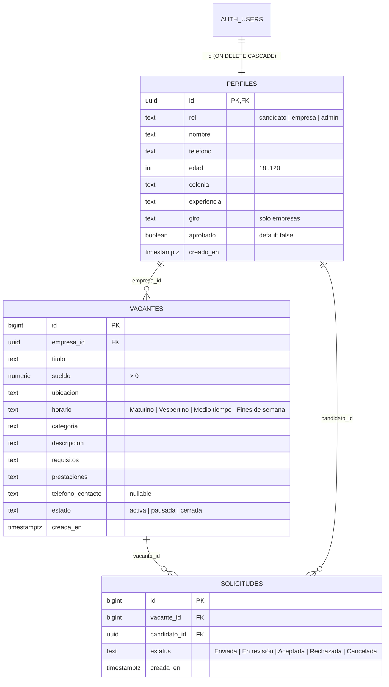
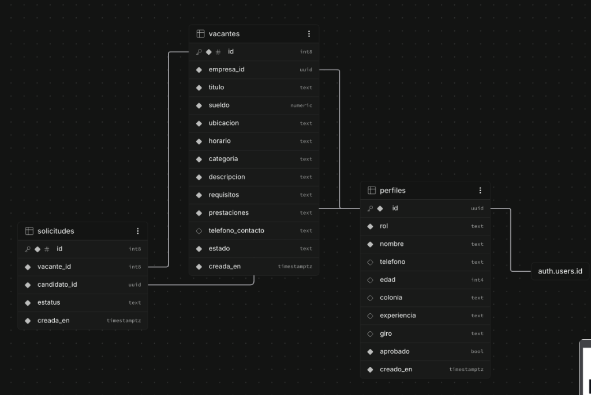

# Bolsa de Trabajo AMAC — Entrega 3 (Final): React, Supabase y Vercel

Aplicación web tipo SPA (*Single Page Application*) para la plataforma de empleo de personas adultas mayores de **AMAC**, construida con **React (Vite)**, **Supabase (PostgreSQL + Auth + Row Level Security)** y desplegada en **Vercel**.

---

## 1. Integrantes del equipo y aportaciones

| Integrante | Qué hizo en esta entrega |
| --- | --- |
| **Gael Sánchez Ramos** | Configuración del proyecto React con Vite (`package.json`, `vercel.json`), migración del sistema de estilos accesibles (`src/styles/`), diseño y script de base de datos PostgreSQL + políticas RLS (`supabase/esquema.sql`), cliente de Supabase (`src/lib/supabase.js`), contexto global de sesión (`AuthContext.jsx`), protección de rutas por rol (`RutaProtegida.jsx`), componentes de layout (`Encabezado.jsx`, `Pie.jsx`) y módulos de autenticación (`Login.jsx`, `RegistroCandidato.jsx`). |
| **Rossbel Rodríguez Rubio** | Componentes reutilizables de vacantes y estatus (`TarjetaVacante.jsx`, `EtiquetaEstatus.jsx`, `Boton.jsx`), página principal con listado desde Supabase, buscador por palabra clave y filtros combinados por horario y categoría (`ListadoVacantes.jsx`), vista de detalle con botón condicional de llamada telefónica y flujo de postulación validado (`DetalleVacante.jsx`), e historial de postulaciones con cancelación confirmada (`MisSolicitudes.jsx`). |
| **Ivanna Treviño Pérez** | Flujo completo de empresa: panel de administración de vacantes propias con conteo de postulaciones y controles para pausar, reactivar o cerrar ofertas (`EmpresaVacantes.jsx`), formulario validado para publicar nuevas vacantes con teléfono opcional (`PublicarVacante.jsx`), gestión de candidatos postulados y cambio de estatus (`SolicitudesRecibidas.jsx`), funcionalidad extra de edición de perfil (`Perfil.jsx`) y documentación técnica (`README.md`). |

---

## 2. Tecnologías utilizadas y cómo correr el proyecto localmente

### Tecnologías
- **Frontend:** React 18, Vite 6, React Router DOM 6, CSS3 con variables personalizadas y diseño accesible (WCAG AA, texto base $\ge 18\text{ px}$).
- **Backend y Base de Datos:** Supabase (PostgreSQL, Supabase Auth, Row Level Security y Triggers en PL/pgSQL).
- **Despliegue continuo:** Vercel con soporte SPA (`vercel.json`) y HTTPS.

### Instrucciones para ejecutar en local

1. **Clonar el repositorio e instalar dependencias** (requiere Node.js 20 o superior):
   ```bash
   git clone https://github.com/Gael-sanchez-ramos/amac-react.git
   cd amac-react
   npm install
   ```

2. **Configurar las variables de entorno:**
   Crea un archivo `.env.local` en la raíz del proyecto:
   ```env
   VITE_SUPABASE_URL=https://xxxxxxxx.supabase.co
   VITE_SUPABASE_PUBLISHABLE_KEY=sb_publishable_xxxxxxxx
   ```
   *(El archivo `.env.local` está ignorado en `.gitignore` por seguridad).*

3. **Ejecutar el servidor de desarrollo:**
   ```bash
   npm run dev
   ```
   Abre `http://localhost:5173` en tu navegador.

---

## 3. Cuentas de prueba

| Rol / Estado | Correo electrónico | Contraseña | Qué permite probar |
| --- | --- | --- | --- |
| **Candidato aprobado** (`aprobado = true`) | `candidato.aprobado@amac.org` | `Amac2026!` | Postularse a vacantes activas, ver historial en *Mis solicitudes*, cancelar solicitudes pendientes y editar su perfil. |
| **Candidato sin aprobar** (`aprobado = false`) | `candidato.pendiente@amac.org` | `Amac2026!` | Iniciar sesión y explorar vacantes; al intentar postularse, RLS bloquea el `INSERT` y muestra el aviso de aprobación pendiente (`RF-054`). |
| **Empresa** (`rol = 'empresa'`) | `empresa@mercadodelbarrio.com` | `Amac2026!` | Publicar vacantes, pausar/reactivar/cerrar vacantes propias y cambiar el estatus de solicitudes recibidas (*En revisión*, *Aceptada*, *Rechazada*). |

---

## 4. Diagrama de la base de datos y políticas RLS

### Diagrama Entidad-Relación (PostgreSQL en Supabase)



### Captura del Schema Visualizer de Supabase



### Explicación de las políticas Row Level Security (RLS)

Todas las tablas (`public.perfiles`, `public.vacantes`, `public.solicitudes`) tienen **RLS activado** (`ENABLE ROW LEVEL SECURITY`). El archivo completo se encuentra en [`supabase/esquema.sql`](supabase/esquema.sql):

1. **Tabla `public.perfiles`:**
   - `"Cada quien ve su perfil"` (`SELECT`): Permite a cada usuario autenticado leer su propia fila (`id = auth.uid()`).
   - `"Todos ven los perfiles de empresas"` (`SELECT`): Permite que cualquier visitante o candidato consulte el nombre y giro de las empresas (`rol = 'empresa'`) al hacer `JOIN` desde el listado de vacantes.
   - `"La empresa ve a quien aplicó a sus vacantes"` (`SELECT`): Mediante la función `public.empresa_ve_candidato(id)`, una empresa solo puede leer los perfiles de los candidatos que se han postulado a alguna de sus vacantes.
   - `"Cada quien edita su perfil"` (`UPDATE`): Permite que un usuario actualice únicamente su propio perfil, combinado con `REVOKE UPDATE` y `GRANT UPDATE (nombre, telefono, edad, colonia, experiencia, giro)` para impedir que alguien modifique su columna `rol` o se cambie `aprobado` a `true` desde el navegador.

2. **Tabla `public.vacantes`:**
   - `"Ver vacantes activas o las propias"` (`SELECT`): El público solo ve vacantes con `estado = 'activa'`, mientras que la empresa dueña (`empresa_id = auth.uid()`) ve también sus vacantes pausadas o cerradas.
   - `"El candidato sigue viendo las vacantes a las que aplicó"` (`SELECT`): Usa `public.candidato_aplico(id)` para que el candidato conserve acceso al detalle de una vacante en *Mis solicitudes* aunque la empresa la pause después (`RF-021`).
   - `"Solo empresas publican, a su nombre"` (`INSERT`): Verifica que `empresa_id = auth.uid()` y que `public.mi_rol() = 'empresa'`.
   - `"La empresa edita sus vacantes"` (`UPDATE`): Solo la empresa autora puede cambiar el estado (`activa`, `pausada`, `cerrada`) o datos de sus vacantes.

3. **Tabla `public.solicitudes`:**
   - `"Candidato ve las suyas; empresa ve las de sus vacantes"` (`SELECT`): Un candidato solo ve las filas donde `candidato_id = auth.uid()`; una empresa solo ve las solicitudes asociadas a vacantes cuyo `empresa_id = auth.uid()`.
   - `"Solo candidatos aprobados se postulan"` (`INSERT`): Valida en PostgreSQL que `candidato_id = auth.uid()`, el estatus inicial sea `'Enviada'` y `public.candidato_aprobado()` sea `true` (`RF-054`). Además, la restricción `UNIQUE (vacante_id, candidato_id)` impide postularse dos veces (`RF-004`).
   - `"Candidato cancela si no está resuelta"` (`UPDATE`): Permite al candidato cambiar el estatus a `'Cancelada'` únicamente si el estatus actual es `'Enviada'` o `'En revisión'` (`RF-006`).
   - `"Empresa cambia el estatus"` (`UPDATE`): Permite a la empresa dueña de la vacante actualizar el estatus a `'En revisión'`, `'Aceptada'` o `'Rechazada'`, siempre que la solicitud no haya sido `'Cancelada'` (`RF-024`). Además, `GRANT UPDATE (estatus)` asegura que no se puedan alterar las llaves foráneas.

---

## 5. Tabla de Requerimientos Funcionales (RF) implementados

| # | Requerimiento | Descripción | Estado |
| --- | --- | --- | --- |
| 1 | **RF-001** | Listado de vacantes desde la BD (solo vacantes con estado `activa` y `JOIN` con empresa) | ✅ Completo |
| 2 | **RF-002, RF-007** | Búsqueda por palabra clave (título o ubicación con `ilike`) + filtros por horario y categoría + mensaje *"No hay vacantes para mostrar."* | ✅ Completo |
| 3 | **RF-003, RF-051** | Detalle de vacante con todos los datos y botón `"Llamar"` (`<a href="tel:...">`) condicional solo si la vacante tiene teléfono | ✅ Completo |
| 4 | **RF-011, RF-012, RF-013** | Registro de candidato (nombre, correo, contraseña, teléfono, edad 18–120, colonia, experiencia y casilla obligatoria de términos) | ✅ Completo |
| 5 | **RF-008, RF-009** | Inicio y cierre de sesión con Supabase Auth y mensaje de error genérico ante credenciales inválidas | ✅ Completo |
| 6 | **RF-004, RF-054** | Postulación a vacantes restringida a candidatos aprobados (`aprobado = true`), sin duplicados (`UNIQUE`) y confirmación en pantalla | ✅ Completo |
| 7 | **RF-005, RF-006** | *Mis solicitudes* con fecha, vacante, empresa, estatus y botón de cancelar con confirmación (bloqueado en *Aceptada*/*Rechazada*) | ✅ Completo |
| 8 | **RF-015** | Registro de empresa simplificado (nombre de la empresa, giro, teléfono, correo y contraseña) | ✅ Completo |
| 9 | **RF-019** | Publicar vacante con todos los campos validados y teléfono solo si elige recibir postulaciones por teléfono | ✅ Completo |
| 10 | **RF-020, RF-021** | *Mis vacantes* de la empresa con contador de solicitudes recibidas y botones para pausar, reactivar y cerrar | ✅ Completo |
| 11 | **RF-022, RF-024** | *Solicitudes recibidas* mostrando nombre, edad, colonia y experiencia del candidato + cambio de estatus (*En revisión*, *Aceptada*, *Rechazada*) | ✅ Completo |
| 12 | **RF-010** | Rutas protegidas por rol en React (`<RutaProtegida />`) + seguridad por fila (RLS) en PostgreSQL | ✅ Completo |
| Extra | **RF-014, RF-017** | **(Puntos extra)** Edición de perfil en tiempo real para candidatos y empresas (`/perfil`) | ✅ Completo |
